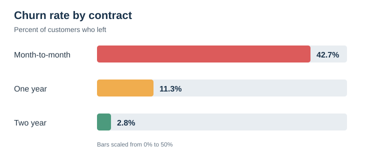

# Telco Customer Churn

Can we spot customers who may leave a telecom service? This is my classification practice project using the [Telco Customer Churn dataset](https://www.kaggle.com/datasets/blastchar/telco-customer-churn). The data describes a **fictional** company, so this is a model experiment, not a real retention result.

I kept the [notebook](telco-customer-churn.ipynb) close to how I learned: code, then a short explanation of what the result means and why I made the next choice.

## What I did

1. Checked missing values, distinct values, and data types.
2. Explored churn by contract type and customer tenure.
3. Removed 11 rows with blank `TotalCharges` (all had `tenure = 0`), then converted that column to a number.
4. Split customers into stratified train and validation groups. `customerID` was excluded from model inputs.
5. Compared a majority-class baseline, Logistic Regression, Random Forest, KNN, and XGBoost on the same split.
6. Tested removing `gender` and `PhoneService`, inspected mistakes, and compared decision thresholds.

## What stood out

Month-to-month customers had a **42.7%** churn rate, versus **11.3%** for one-year and **2.8%** for two-year contracts. Their median tenure was also much shorter: **12 months**, versus 44 and 64. This is a pattern worth investigating, not proof that a longer contract would prevent churn.

## Model results

| Model | Train AUC | Validation AUC | F1 | Recall |
|---|---:|---:|---:|---:|
| Majority-class baseline | 0.500 | 0.500 | 0.000 | 0.000 |
| Logistic Regression | 0.851 | 0.836 | 0.608 | 0.572 |
| Random Forest | 1.000 | 0.814 | 0.554 | 0.492 |
| KNN | 0.887 | 0.797 | 0.558 | 0.570 |
| XGBoost | 0.876 | **0.837** | 0.587 | 0.543 |

XGBoost had the highest validation AUC by just 0.001. I continued with Logistic Regression because its F1 and recall were better and its train/validation gap was smaller. Removing `gender` and `PhoneService` gave a tiny change on this split: AUC **0.836**, F1 **0.611**, recall **0.578**. I would not claim that this proves those features are useless.

At the default **0.5** threshold, the reduced model caught **216 of 374** customers who churned and incorrectly flagged **117** who stayed. At **0.4**, it caught **256 of 374** (68.4% recall) and incorrectly flagged **186**. I chose 0.4 as a retention-focused example: fewer missed churn cases, but more outreach. I did **not** optimize this threshold for profit because the dataset has no outreach costs or intervention outcomes.

## Limits

- I used one validation split to choose the model, features, and threshold. The reported scores may therefore be optimistic; repeated validation and an untouched test set would make a stronger claim.
- The data is a fictional sample. No real business impact or causal effect can be inferred from these correlations or model scores.
- This is a Kaggle **dataset**, not a competition with a submission leaderboard.

## Run it

Open `telco-customer-churn.ipynb` on Kaggle and attach the [source dataset](https://www.kaggle.com/datasets/blastchar/telco-customer-churn), or put its CSV under `/kaggle/input/` in a compatible environment. The notebook looks for `WA_Fn-UseC_-Telco-Customer-Churn.csv`. Run cells from top to bottom. The dataset is not copied into this repository.

Tools: Python, pandas, scikit-learn, XGBoost, Matplotlib.
